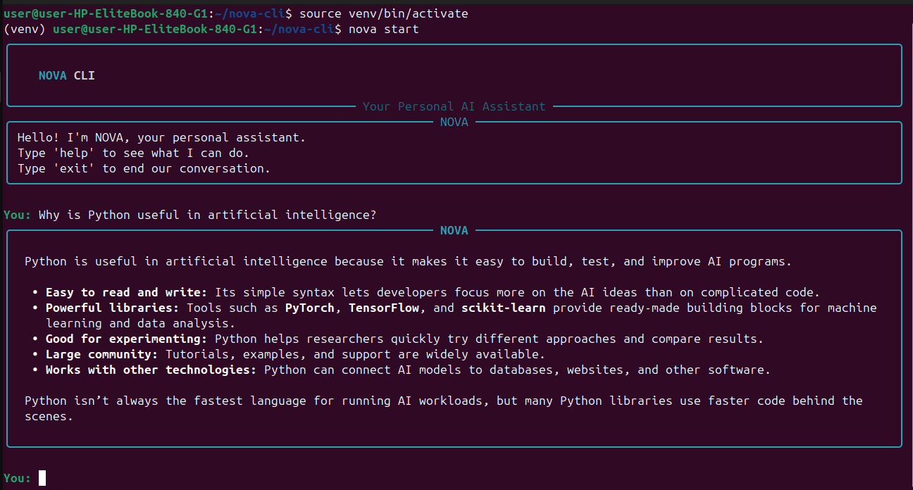

# NOVA CLI 🤖

### Your Personal AI-Powered Command-Line Assistant

NOVA CLI is a Python-based personal assistant that combines AI-powered conversations, productivity tools and programming education in an interactive terminal application.

Built as a hands-on Python and AI development project, NOVA demonstrates modular application design, API integration, conversation memory, local data persistence and command-line development.

## 🚀 Features

### 🤖 AI-Powered Conversations
- Communicate with an AI model through the OpenAI API.
- Generate dynamic responses to general questions.
- Maintain conversation context during an active session.
- Clear conversation memory whenever needed.

### 📝 Note Management
- Create and save personal notes.
- View saved notes.
- Delete notes using their unique IDs.
- Store notes locally using JSON.

### ✅ Task Management
- Create tasks with titles and descriptions.
- View all saved tasks.
- Mark tasks as completed.
- Delete tasks.
- Maintain task data locally using JSON.

### 🧮 Calculator
- Perform basic mathematical calculations.
- Supports addition, subtraction, multiplication and division.
- Handles invalid expressions and division-by-zero errors.

### 🐍 Python Learning Assistant
- Get explanations of basic Python concepts.
- Explore variables, lists, dictionaries, functions and loops.
- View practical code examples.

### 💻 Terminal Interface
- Interactive command-line experience.
- Styled terminal output using Rich.
- Command management using Typer.

## 🛠️ Technologies Used

| Technology | Purpose |
|---|---|
| Python 3.12 | Core programming language |
| OpenAI API | AI-powered conversations |
| OpenAI Python SDK | API communication |
| Typer | CLI command management |
| Rich | Terminal interface and styling |
| python-dotenv | Environment variable management |
| JSON | Local data persistence |
| Pytest | Automated testing |
| Setuptools | Python package configuration |

## 📁 Project Structure

```text
nova-cli/
│
├── nova/
│   ├── __init__.py
│   ├── main.py
│   ├── assistant.py
│   ├── commands.py
│   ├── ai.py
│   ├── calculator.py
│   ├── learning.py
│   └── storage.py
│
├── data/
│   └── .gitkeep
│
├── tests/
│   └── test_storage.py
│
├── .env.example
├── .gitignore
├── pyproject.toml
├── requirements.txt
└── README.md
```

## ⚙️ Installation

### 1. Clone the repository

```bash
git clone https://github.com/YOUR_USERNAME/nova-cli.git
```

Replace `YOUR_USERNAME` with your GitHub username.

### 2. Navigate into the project

```bash
cd nova-cli
```

### 3. Create a virtual environment

```bash
python3 -m venv venv
```

### 4. Activate the virtual environment

On Linux:

```bash
source venv/bin/activate
```

### 5. Install NOVA and its dependencies

```bash
pip install -e ".[dev]"
```

## 🔐 Environment Configuration

NOVA uses environment variables to manage API credentials.

Create your local environment file:

```bash
cp .env.example .env
```

Configure the following variables inside `.env`:

```env
OPENAI_API_KEY=your_openai_api_key
OPENAI_MODEL=your_supported_model
```

Replace the placeholders with your actual configuration.

**Security:** Never commit your `.env` file or expose your API key publicly.

OpenAI API usage may incur separate charges.

## ▶️ Usage

After installation, start NOVA:

```bash
nova start
```

Display application information:

```bash
nova about
```

View available commands:

```bash
nova --help
```

### Example Interactions

**AI Conversation**

```text
You: Why is Python popular in AI development?

NOVA: Python is popular because of its simple syntax,
extensive libraries and strong developer community.
```

**Calculator**

```text
You: calculate 25 + 15

NOVA: The answer is: 40
```

**Python Learning**

```text
You: explain dictionaries

NOVA: A dictionary stores information as key-value pairs.
```

**Note Management**

```text
You: note add | Learn Python | Study Python functions

NOVA: Note saved successfully!
```

**Task Management**

```text
You: task add | Build a project | Continue developing NOVA

NOVA: Task added successfully!
```

## 🧪 Running Tests

Run the automated tests from the project root:

```bash
python -m pytest -v
```

## 🗺️ Development Roadmap

- [x] Project initialization and modular structure
- [x] Interactive command-line interface
- [x] Terminal styling with Rich
- [x] Interactive conversation engine
- [x] Note management
- [x] Task management
- [x] Calculator tool
- [x] Python learning tool
- [x] OpenAI API integration
- [x] Short-term conversation memory
- [x] Conversation memory management
- [x] Basic automated testing
- [x] Python package configuration
- [ ] Advanced memory management
- [ ] AI agent and function calling
- [ ] Additional productivity tools
- [ ] Expanded automated test coverage

## 📸 Application Preview



## 🎯 Project Goals

NOVA CLI is a practical project focused on developing skills in:

- Python programming and software development.
- AI application development and LLM integration.
- API communication and environment configuration.
- Modular application architecture.
- Data storage and management.
- Command-line application development.

The long-term goal is to evolve NOVA into a more capable AI assistant with intelligent tool selection and automation capabilities.

## 👨‍💻 Author

**Tobenna Okenwa**

Python Developer | Aspiring AI Engineer

---

*Built with Python, curiosity and a passion for AI development.*